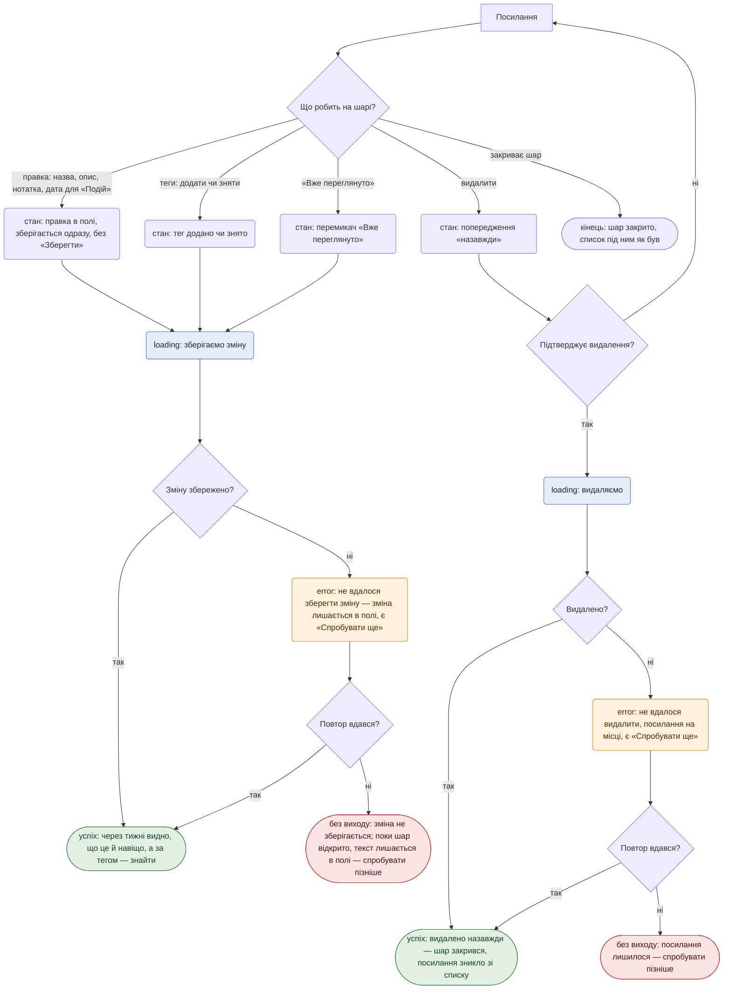
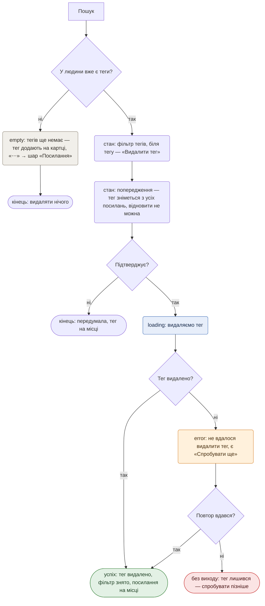
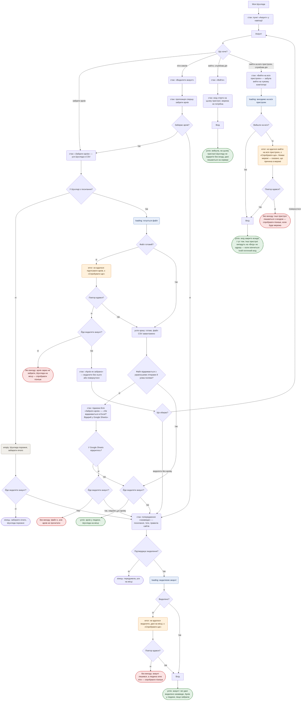

# User flows

Екрани — з реєстру [sitemap.md](sitemap.md), «Екрани»; статуси — з його розділу «Сутності». Jobs — з [11-jtbd.md](research/notes/11-jtbd.md), персони й обставини — з [10-personas.md](research/notes/10-personas.md).

**Нових екранів flows не потребували.** Нові стани, які знайшлися, дописано в `sitemap.md`, «Стани, а не екрани»: з датою рішення PM; ті, що були припущеннями, підтверджено PM 2026-11-25.

## Як читати

| Вузол | Форма | Що це |
|-------|-------|-------|
| Екран | `[Назва]`, прямокутник | Назва дослівно з реєстру екранів. Той самий екран може стояти кілька разів, якщо людина туди повертається. «Пошук» і «Посилання» — шари над поточним екраном |
| Розвилка | `{питання?}`, ромб | Дані можуть не прийти, введення може бути хибним, дія може не пройти |
| Стан | `("...")`, заокруглений | Стан екрана, що стоїть перед ним. Підпис починається з типу: `empty`, `error`, `loading`, `стан`, `успіх кроку` |
| Перехід | `("перехід: ...")` | Далі читати інший flow |
| Кінець | `(["..."])`, овал | `успіх`, `кінець` (людина сама зупинилась) або `без виходу` — людина застрягла, і зараз Шухляда не дає їй виходу |

Тип кінця й стану названо словом, колір лише допомагає. Позначок припущень `[?]` більше немає: 2026-11-25 їх підтверджено PM, як і в `sitemap.md`. Сторінка сайту — не наш екран, тому вона — стан, а не вузол-екран.

## Чому ці jobs

**Main job** — обов'язковий. До нього обрано три related jobs:

| Job | Чому | Сигнал |
|-----|------|--------|
| **R4** Дістати за тим, що пам'ятається | **Найчастіший біль і ядро MVP.** «Знаю, що збережено, але не можу знайти» часто — 6 з 14; пошук мусить пробачати одруківки й інші форми слова, і саме тут найбільше розвилок, де нічого не знаходиться | Важливість 3 для П1 і П2 (`11`, матриця); `09`, розділ 5 |
| **R3** Мати порядок без сортування | **Найчастіша дія після збереження:** категорію вгадуємо в кожному посиланні. Промах категорії — те, від чого П2 втрачає довіру (`10`, «Чим персони відрізняються») | Важливість 3 для П2, 2 для П1 |
| **E2** Не боятися втратити все разом із сервісом | **Найризикованіший:** видалення акаунта остаточне, а експорт — єдиний спосіб забрати архів. Помилка тут не лагодиться | Важливість 2 для П1 і П2; урок Pocket `03·[A17]` |

**Чому немає окремого flow для R1, R2, E1 і E3.** R1 «відкласти, не відриваючись» і E1 «не тримати в голові» вже всередині main job: вставка, «Поділитися», «не вдалося зберегти» й повернення в Telegram — його розвилки. R2 «що це й навіщо» — там само («Дані сторінки прийшли?») і на шарі «Посилання» у flow R3, в частині «далі»: правка, теги, «Вже переглянуто», видалення. E3 — відчуття від «Моєї Шухляди», а не шлях з розвилками. R5 поза MVP.

**Межі.** Частоти — з опитування 14 людей з кола PM: орієнтир, не статистика (`09`, розділ 2). Flows не перевірено на людях.

## Рішення PM (2026-11-22)

Flows показали три тупики; щоб людина в них не застрягала, PM вирішила (бриф §3.1, §3.4, §3.5):
- **Три невдалі спроби** (Main): у повідомленні — «Скопіювати посилання». Посилання не в Шухляді, але людина його не губить і збереже пізніше.
- **Нічого не знайшлося** (R4): сказано, де шукали, а під повідомленням — категорії й «Нещодавно додане», щоб піти гортати.
- **Файл експорту не читається** (E2): CSV з позначкою кодування (BOM) і підказка «Не відкривається в Excel? Відкрий у Google Sheets». Роздільник — на етап 3.

Тупик «сторінки сайту вже немає» лишається свідомо: копій сторінок Шухляда не робить (бриф §4).

## Рішення PM (2026-11-24)

Сувора критика flows знайшла ще тупики й відсутні стани. PM вирішила (бриф §3.1, §3.5, §9):
- **«Поділитися» до входу** (Main): посилання приходить першим і чекає, поки людина ввійде й Шухляда завантажиться. Якщо вхід чи завантаження не вдалися — у помилці «Скопіювати посилання».
- **Без мережі** (Main): у помилці — «Спробувати ще» і «Скопіювати посилання», як після третьої спроби.
- **Помилка дії в підтвердженні** — «Змінити» чи «Скасувати» (Main, R3) — показується на картці: підтвердження зникає за кілька секунд, і помилка лишилася б без кнопки. Не встигла скасувати — «Видалити» на шарі «Посилання».
- **Бита картка** (Main, R4): сторінки вже немає — посилання можна прибрати «Видалити» на шарі «Посилання». Сам тупик лишається: копій сторінок немає.
- **Експорт не вдався перед видаленням акаунта** (E2): «Архів не забрано» — людина повертається на «Акаунт» або видаляє без архіву, після попередження «назавжди».
- **Вихід — службова дія, як «Вхід»** (E2): job його не просить. Виходимо на самому пристрої, без мережі, тож помилки виходу немає. Як саме — перевіримо на етапі 3.
- **«Вийти на всіх пристроях»** (E2) — друга службова дія на «Акаунті», для входу, який лишився на чужому комп'ютері. Потребує мережі, тож має завантаження, помилку й повтор. Закриває вхід і на цьому пристрої; інші випадуть на «Вхід» не одразу, а коли скінчиться їхній поточний вхід — скільки це, перевіримо на етапі 3.
- **Другий захід перевіряє вхід** (Main): хто виходив на цьому пристрої, знову проходить «Вхід».
- **Тегів ще немає** (R3, «далі»; R4): у фільтрі тегів «Пошуку» — порожній стан з підказкою, де теги додають.
- **«Скопіювати посилання» — у кожній невдачі збереження** (Main), не лише після третьої спроби й без мережі: людина може закрити картку раніше, а після «Поділитися» посилання немає в буфері.
- **5 с для «Поділитися» без входу** (Main): час входу не рахуємо, як і в «Глибині» (бриф §9).
- **Порожніх станів 7, усі лишаються**: перелік — у `sitemap.md`, «Стани, а не екрани».

Решта правок — моделювання: виходи з кіл, стани завантаження й помилок, вихід з акаунта, дії на шарі «Посилання» (flow R3, «далі») і пошук за тегом (R4).

---

## Екрани у flows

**2026-11-25.** Перевірка перед кроком 08: чи є кожен екран із `sitemap.md` хоча б в одному flow. Є всі п'ять, тож окремих flows не дописано.

| Екран | Flow | Звідки приходять | Куди йдуть далі |
|-------|------|------------------|-----------------|
| Моя Шухляда · головний | Main, R4, R3, E2 | З домашнього екрана телефона, «Поділитися», після «Входу» | Вставка → «Збережено в Шухляді»; картка → сторінка сайту; категорія, тег чи поле пошуку → «Пошук»; «⋯» → «Посилання»; «Акаунт» |
| Пошук · шар | R4, «R3, далі» | Поле пошуку в шапці, `Ctrl+K` / `/`, категорія чи тег у сайдбарі, чип тегу | Картка → сторінка сайту; «⋯» → «Посилання»; «Видалити тег»; «Закрити» → екран під шаром |
| Посилання · шар | Main («Вже в Шухляді»), R3, «R3, далі» | «⋯» на картці — на головному чи в результатах пошуку; «Вже в Шухляді» | Правка, категорія, теги, «Вже переглянуто» — лишається на шарі; «Видалити» → список без картки; «Закрити» → екран під шаром |
| Акаунт | E2 | Пункт «Акаунт» у навігації | Експорт → файл; «Вийти», «Вийти на всіх пристроях», видалення акаунта → «Вхід» |
| Вхід · службовий | Main, E2 | Перший захід без входу; «Поділитися» до входу; вихід чи видалення акаунта | «Увійти через Google» → «Моя Шухляда» |

---

## Main. Відкласти за мить і дістати, коли знадобиться

[Main job](research/notes/11-jtbd.md#main-job). **Персона:** П1 «Скидає з телефона» (primary). **Обставини:** телефон; посилання трапилось у стрічці чи чаті — найчастіше в YouTube, Instagram, Telegram. Відкласти треба одним рухом, не збившись із того, що робить (`10`, П1, job 1); на Android — ще й «Поділитися», на iPhone — лише вставка. Дістає потім, гортаючи очима (`10`, П1, job 2). Flow охоплює два заходи: відкласти зараз і дістати через дні. Job закрито, коли людина відкрила потрібну сторінку.

```mermaid
flowchart TD
    dWay{"Як відкриває Шухляду?"}
    dWay -->|"з домашнього екрана телефона, щоб вставити"| home[Моя Шухляда]
    dWay -->|"«Поділитися → Шухляда», лише Android"| share("стан: посилання прийшло з «Поділитися», Шухляда тримає його, поки людина входить і Шухляда завантажується")
    share --> home
    home --> dSession{"Людина вже ввійшла?"}
    dSession -->|так| loadHome("loading: завантажуємо Шухляду")
    dSession -->|ні| login[Вхід]
    login --> loadLogin("loading: вхід через Google")
    loadLogin --> dLogin{"Вхід вдався?"}
    loadLogin -->|«Скасувати»| login
    dLogin -->|так| loadHome
    dLogin -->|ні| errLogin("error: не вдалося увійти, є «Спробувати ще». Прийшли з «Поділитися» — ще «Скопіювати посилання»")
    errLogin --> dLoginRetry{"Повтор вдався?"}
    dLoginRetry -->|так| loadHome
    dLoginRetry -->|ні| deadLogin(["без виходу: без входу не зберегти, лишається спробувати пізніше. Посилання не губиться: при вставці воно в буфері, з «Поділитися» — «Скопіювати посилання»"])

    loadHome --> dData{"Шухляда завантажилась?"}
    dData -->|ні| errHome("error: не вдалося завантажити Шухляду, є «Спробувати ще». Прийшли з «Поділитися» — ще «Скопіювати посилання»")
    errHome --> dHomeRetry{"Повтор вдався?"}
    dHomeRetry -->|ні| deadHome(["без виходу: Шухляда не відповідає, лишається прийти пізніше. Посилання не губиться, як після невдалого входу"])
    dHomeRetry -->|так| dEmpty
    dData -->|так| dEmpty{"У Шухляді вже є посилання?"}
    dEmpty -->|ні| empty("empty: Шухляда порожня, ілюстрація, поле — єдина дія")
    dEmpty -->|так| list("стан: поле нагорі, «Нещодавно додане», категорії з кількістю")
    empty --> dShared{"Посилання прийшло з «Поділитися»?"}
    list --> dShared
    dShared -->|ні| paste("стан: дотик до поля, системне «Вставити»")
    dShared -->|так| dIsLink
    paste --> dIsLink{"Вставлене — посилання?"}
    dIsLink -->|ні| errNotLink("error: це не посилання, підказка скопіювати посилання")
    errNotLink --> dHasLink{"Є посилання, щоб вставити?"}
    dHasLink -->|так| paste
    dHasLink -->|ні| endNotLink(["кінець: закриває підказку й іде по посилання. З «Поділитися» — «Назад» телефона в застосунок"])
    dIsLink -->|так| dDup{"Таке посилання вже є в Шухляді?"}
    dDup -->|так| dup("стан: «Вже в Шухляді» з переходом до наявного")
    dup --> dGoDup{"Переходить до наявного?"}
    dGoDup -->|ні| okDup(["успіх: посилання вже в Шухляді, вдруге відкладати не треба"])
    dGoDup -->|так| linkDup[Посилання]
    linkDup --> loadDup("loading: завантажуємо посилання")
    loadDup --> dDupOpen{"Посилання відкрилось?"}
    dDupOpen -->|так| okDupSeen(["успіх: відкладено раніше, видно, де лежить"])
    dDupOpen -->|ні| errDup("error: не вдалося завантажити посилання, є «Спробувати ще»")
    errDup --> dDupRetry{"Повтор вдався?"}
    dDupRetry -->|так| okDupSeen
    dDupRetry -->|"ні, закриває шар"| okDup
    dDup -->|ні| dNet{"Є мережа?"}
    dNet -->|ні| errNet("error: не вдалося зберегти — немає мережі, спробуй пізніше. Є «Спробувати ще» і «Скопіювати посилання». Спроба не рахується")
    errNet --> dNetBack{"Мережа повернулася, поки картка відкрита?"}
    dNetBack -->|"так, «Спробувати ще»"| saving
    dNetBack -->|ні| dCopy
    dNet -->|так| saving("loading: вкладається, анімація «вкладання», на картці домен")
    saving --> dSaved{"Збереглося?"}
    dSaved -->|ні| errSave("error: не вдалося зберегти, є «Спробувати ще» і «Скопіювати посилання»")
    errSave --> dTries{"Це була третя спроба?"}
    dTries -->|ні| dRetry{"Пробує ще раз?"}
    dRetry -->|"так, «Спробувати ще»"| dNet
    dRetry -->|"ні, закриває картку"| dCopy
    dTries -->|так| errFinal("error: третя спроба — повідомлення без повтору і «Скопіювати посилання»")
    errFinal --> dCopy{"Скопіювала посилання?"}
    dCopy -->|так| endCopy(["кінець: у Шухляді посилання немає, але воно в людини — збереже пізніше"])
    dCopy -->|ні| deadSave(["без виходу: людина закриває картку, посилання не збереглося і не скопійоване"])
    dSaved -->|так| dWrap{"Це обгортка, яку не вдалося розгорнути?"}
    dWrap -->|так| wrapFail("стан: «Збережено в Шухляді», але домен обгортки, наприклад linkedin.com, і категорію вгадано хибно")
    wrapFail --> linkR3
    dWrap -->|ні| saved("успіх кроку: «Збережено в Шухляді», домен і категорія, «Змінити», «Скасувати»")
    saved --> meta("loading: підтягується назва, опис, іконка")
    meta --> dMeta{"Дані сторінки прийшли?"}
    dMeta -->|так| full("стан: повні — назва, опис, іконка")
    dMeta -->|ні| domain("стан: лише домен, м'яка заглушка замість іконки")
    full --> dCat{"Категорію вгадано правильно?"}
    domain --> dCat
    dCat -->|ні| linkR3("перехід: flow R3")
    dCat -->|так| dOops{"Вставила випадково?"}
    dOops -->|так| dInTime{"«Скасувати» ще на екрані?"}
    dInTime -->|ні| delLater("перехід: flow R3, «Видалити» на шарі «Посилання», 3 кліки")
    dInTime -->|так| cancelling("loading: скасовуємо")
    cancelling --> dCancelled{"Скасовано?"}
    dCancelled -->|так| cancel("стан: скасовано, картки немає")
    cancel --> endCancel(["кінець: випадкову вставку прибрано, Г5"])
    dCancelled -->|ні| errCancel("error: не вдалося скасувати — на картці, бо підтвердження зникає; є «Спробувати ще»")
    errCancel --> dCancelRetry{"Повтор вдався?"}
    dCancelRetry -->|так| cancel
    dCancelRetry -->|ні| delLater
    dOops -->|ні| dFrom{"Прийшла через «Поділитися»?"}
    dFrom -->|так| back("стан: «Назад» телефона — знову в Telegram")
    dFrom -->|ні| stay("стан: картка зверху «Нещодавно доданого»")
    back --> later("стан: минають дні, річ знадобилася")
    stay --> later

    later --> home2[Моя Шухляда]
    home2 --> dSession2{"Людина ще ввійшла на цьому пристрої?"}
    dSession2 -->|так| load2("loading: завантажуємо Шухляду")
    dSession2 -->|"ні, виходила"| login2[Вхід]
    login2 --> loadLogin2("loading: вхід через Google")
    loadLogin2 --> dLogin2{"Вхід вдався?"}
    loadLogin2 -->|«Скасувати»| login2
    dLogin2 -->|так| load2
    dLogin2 -->|ні| errLogin2("error: не вдалося увійти, є «Спробувати ще»")
    errLogin2 --> dLoginRetry2{"Повтор вдався?"}
    dLoginRetry2 -->|так| load2
    dLoginRetry2 -->|ні| deadLogin2(["без виходу: без входу не дістати, лишається спробувати пізніше"])
    load2 --> dData2{"Шухляда завантажилась?"}
    dData2 -->|ні| errHome2("error: не вдалося завантажити Шухляду, є «Спробувати ще»")
    errHome2 --> dHomeRetry2{"Повтор вдався?"}
    dHomeRetry2 -->|ні| deadHome2(["без виходу: Шухляда не відповідає, лишається прийти пізніше"])
    dHomeRetry2 -->|так| dRecent
    dData2 -->|так| dRecent{"Річ видно в «Нещодавно доданому»?"}
    dRecent -->|ні| linkR4("перехід: flow R4")
    dRecent -->|так| tap("стан: дотик до картки — сторінка сайту в новій вкладці")
    tap --> dPage{"Сторінка відкривається?"}
    dPage -->|так| ok(["успіх: річ дістала, не пам'ятаючи, де й коли відклала"])
    dPage -->|ні| gone("стан: сайт показує, що сторінки вже немає. Шухляда цього не бачить, копій сторінок не робить, бриф §4")
    gone --> dClean{"Прибирає биту картку?"}
    dClean -->|так| delLater
    dClean -->|ні| deadPage(["без виходу: посилання є, а сторінки вже немає"])

    classDef cOk fill:#e3f1e5,stroke:#2e7d32,color:#1b3d20
    classDef cDead fill:#fbe4e4,stroke:#c62828,color:#4a1212
    classDef cErr fill:#fff1dc,stroke:#d9822b,color:#4a2c0a
    classDef cLoad fill:#e7eefa,stroke:#3d6db5,color:#14284a
    classDef cEmpty fill:#f1efea,stroke:#8a8172,color:#2e2a24
    class ok,okDup,okDupSeen cOk
    class deadLogin,deadLogin2,deadHome,deadHome2,deadSave,deadPage cDead
    class errLogin,errLogin2,errHome,errHome2,errNotLink,errNet,errSave,errFinal,errDup,errCancel cErr
    class loadHome,loadLogin,loadLogin2,saving,meta,load2,loadDup,cancelling cLoad
    class empty cEmpty
```

**Розвилки:**
1. **Як відкриває Шухляду?** З домашнього екрана телефона, щоб вставити (iPhone і Android), або «Поділитися» (лише Android). «Поділитися» стоїть першим: посилання приходить ще до входу й завантаження і мусить їх пережити (рішення PM 2026-11-24).
2. **Людина вже ввійшла?** Ні — «Вхід» (рішення PM 2026-11-21: спершу вхід).
3. **Вхід вдався?** Ні — помилка з «Спробувати ще»; хто прийшов з «Поділитися», має ще «Скопіювати посилання». Поки вхід триває, «Скасувати» повертає на «Вхід» (2026-11-25).
4. **Повтор входу вдався?** Ні — без виходу, але посилання не губиться.
5. **Шухляда завантажилась?** Ні — помилка з «Спробувати ще» і, для «Поділитися», «Скопіювати посилання».
6. **Повтор завантаження вдався?** Ні — без виходу, посилання не губиться.
7. **У Шухляді вже є посилання?** Ні — порожній стан.
8. **Посилання прийшло з «Поділитися»?** Так — одразу перевірка; ні — вставка.
9. **Вставлене — посилання?** Ні — підказка.
10. **Є посилання, щоб вставити?** Так — знову вставка; ні — кінець: людина йде по посилання, з «Поділитися» — «Назад» у застосунок.
11. **Таке посилання вже є?** Так — «Вже в Шухляді»; порівнюємо очищені адреси (бриф §3.1).
12. **Переходить до наявного?** Ні — успіх, посилання вже лежить; так — шар «Посилання».
13. **Посилання відкрилось?** Ні — помилка з «Спробувати ще».
14. **Повтор вдався?** Ні — людина закриває шар; посилання однаково в Шухляді, тож це успіх.
15. **Є мережа?** Ні — «не вдалося зберегти» з причиною, «Спробувати ще» і «Скопіювати посилання»; спроба не рахується (рішення PM 2026-11-24).
16. **Мережа повернулася, поки картка відкрита?** Так — «Спробувати ще»; ні — чи скопіювала посилання.
17. **Збереглося?** Ні — «Спробувати ще» і «Скопіювати посилання»: «Скопіювати» є в кожній невдачі, не лише після третьої (рішення PM 2026-11-24).
18. **Це була третя спроба?** Ні — чи пробує людина ще раз. Так — повідомлення без повтору, але з «Скопіювати посилання» (бриф §3.1, рішення PM 2026-11-22).
19. **Пробує ще раз?** Так — «Спробувати ще», і знову перевіряємо мережу: зникла — спроба не рахується. Ні — людина закриває картку раніше, тож спершу чи скопіювала посилання: після «Поділитися» його немає в буфері.
20. **Скопіювала посилання?** Після третьої спроби, без мережі чи коли закриває картку раніше. Так — кінець, посилання в людини; ні — без виходу.
21. **Це обгортка, яку не вдалося розгорнути?** Так — домен обгортки й хибна категорія, далі flow R3 (бриф §3.1).
22. **Дані сторінки прийшли?** Ні — лише домен.
23. **Категорію вгадано правильно?** Ні — flow R3.
24. **Вставила випадково?** Так — «Скасувати» (Г5).
25. **«Скасувати» ще на екрані?** Ні — видалити через шар «Посилання», flow R3.
26. **Скасовано?** Ні — помилка на картці з «Спробувати ще».
27. **Повтор вдався?** Ні — видалити через шар «Посилання».
28. **Прийшла через «Поділитися»?** Так — «Назад» телефона веде назад у Telegram.
29. **Людина ще ввійшла на цьому пристрої?** (другий захід) Ні, бо виходила — знову «Вхід».
30. **Вхід вдався?** Ні — помилка з «Спробувати ще». Поки вхід триває, «Скасувати» повертає на «Вхід».
31. **Повтор входу вдався?** Ні — без виходу.
32. **Шухляда завантажилась?** (другий захід) Ні — помилка з «Спробувати ще».
33. **Повтор вдався?** Ні — без виходу.
34. **Річ видно в «Нещодавно доданому»?** Ні — flow R4.
35. **Сторінка відкривається?** Ні — сторінки вже немає.
36. **Прибирає биту картку?** Так — «Видалити» на шарі «Посилання», flow R3; ні — без виходу.

**Стани:**
- **empty:** Шухляда порожня — ілюстрація, поле єдина дія.
- **loading:** вхід через Google (на обох заходах); завантажуємо Шухляду (на обох заходах); `вкладається`; `підтягується` назва, опис, іконка; завантажуємо посилання; скасовуємо.
- **error:** не вдалося увійти (на обох заходах); не вдалося завантажити Шухляду (на обох заходах); вставлене — не посилання; не вдалося завантажити посилання; немає мережі — з «Спробувати ще» і «Скопіювати посилання»; не вдалося зберегти — теж з «Спробувати ще» і «Скопіювати посилання»; третя спроба — без повтору, з «Скопіювати посилання»; не вдалося скасувати — на картці.
- **стан:** посилання з «Поділитися» чекає входу; сайт показує, що сторінки вже немає — це стан сторінки сайту, а не нашого екрана; поле й «Нещодавно додане»; «Вже в Шухляді»; обгортку не розгорнуто; `повні`; `лише домен`; `скасовано`; повернення в Telegram; картка зверху списку; сторінка сайту в новій вкладці.
- **успіх кроку:** «Збережено в Шухляді» з «Змінити» і «Скасувати».

**Кінці:**
- **успіх:** річ дістала — job закрито; «Вже в Шухляді» — відкладено раніше, з переходом до наявного чи без.
- **кінець:** вставлене — не посилання, людина йде по посилання; випадкову вставку прибрано; без мережі, після трьох спроб чи коли картку закрито раніше посилання скопійоване — людина збереже пізніше.
- **без виходу:** вхід не вдається (на обох заходах); Шухляда не відповідає (на обох заходах); посилання не збереглося і не скопійоване; сторінки вже немає, а биту картку людина лишила. Коли вхід чи Шухляда підводять на першому заході, посилання не губиться.

**Кліків:** відкласти — 1 (дотик до поля), дістати нещодавно додане — 1 (дотик до картки), як у `sitemap.md`, «Глибина». Дотиків пальцем на вставку більше: на iPhone 3, на Android 2 (там само).

---

## R4. Дістати за тим, що пам'ятається

[R4](research/notes/11-jtbd.md#r4--дістати-за-тим-що-памятається). **Персона:** П1 (primary), той самий шлях у П2. **Обставини:** річ знадобилася, а в «Нещодавно доданому» її вже не видно (перехід з main job). Пам'ятає «про що воно» — 12 з 14, сайт — лише 2 (`09`, розділ 5). П1 спершу гортає, П2 частіше шукає словом. Гілка «тегом» — для тих, хто ставить теги: теги цінують переважно поза персонами (`11`, «Функції-кандидати на видалення»), але саме за ними R4 стоїть на шарі «Посилання». Ціль — знайти до 10 с (бриф §9). Гілка «Шухляда порожня» — для новачка, зокрема П3: він відкриває «Пошук», ще нічого не відклавши.

```mermaid
flowchart TD
    home[Моя Шухляда] --> dHow{"Як шукає?"}
    dHow -->|гортає категорію| cat("стан: дотик до категорії з кількістю")
    dHow -->|тегом| tagOpen("стан: тег у сайдбарі чи чип тегу на картці")
    dHow -->|словом| open("стан: поле пошуку в шапці або Ctrl+K")
    cat --> search[Пошук]
    tagOpen --> search
    open --> search
    search --> dFilter{"З яким фільтром відкрито?"}
    dFilter -->|тег| dHasTags{"У людини вже є теги?"}
    dHasTags -->|ні| noTags("empty: тегів ще немає — тег додають на картці, «⋯» → шар «Посилання»")
    noTags --> query
    dHasTags -->|так| loadTag("loading: завантажуємо посилання з тегом")
    loadTag --> dTagLoaded{"Тег завантажився?"}
    dTagLoaded -->|ні| errTagLoad("error: не вдалося завантажити тег, є «Спробувати ще»")
    errTagLoad --> dTagRetry{"Повтор вдався?"}
    dTagRetry -->|ні| deadTagLoad(["без виходу: Шухляда не відповідає, лишається прийти пізніше"])
    dTagRetry -->|так| dTagEmpty
    dTagLoaded -->|так| dTagEmpty{"З цим тегом є посилання?"}
    dTagEmpty -->|ні| emptyTag("empty: з цього тегу знято всі посилання — тег лишається, бриф §3.2")
    emptyTag --> query
    dTagEmpty -->|так| tagList("стан: усі посилання з тегом, новіше першим")
    tagList --> dSeenTag{"Річ видно серед них?"}
    dSeenTag -->|так| tap
    dSeenTag -->|ні| query
    dFilter -->|категорія| loadCat("loading: завантажуємо категорію")
    loadCat --> dCatLoaded{"Категорія завантажилась?"}
    dCatLoaded -->|ні| errCat("error: не вдалося завантажити категорію, є «Спробувати ще»")
    errCat --> dCatRetry{"Повтор вдався?"}
    dCatRetry -->|ні| deadCat(["без виходу: Шухляда не відповідає, лишається прийти пізніше"])
    dCatRetry -->|так| dCatEmpty
    dCatLoaded -->|так| dCatEmpty{"У категорії є посилання?"}
    dCatEmpty -->|ні| emptyCat("empty: у цій категорії ще нічого, ілюстрація")
    emptyCat --> query
    dCatEmpty -->|так| catList("стан: уся категорія, новіше першим")
    catList --> dSeen{"Річ видно в категорії?"}
    dSeen -->|так| tap
    dSeen -->|ні| query
    dFilter -->|без фільтра| dAny{"У Шухляді є посилання?"}
    dAny -->|ні| emptyAll("empty: Шухляда порожня — спершу відклади посилання, поле поруч")
    emptyAll --> linkMain("перехід: flow Main, вставка")
    dAny -->|так| emptyQ("стан: запит порожній — базовий вигляд, видно «Нещодавно додане»")
    emptyQ --> dSeenRecent{"Річ видно серед нещодавно доданого?"}
    dSeenRecent -->|так| tap
    dSeenRecent -->|ні| query("стан: вводить, що пам'ятає, своїми словами, з помилкою чи без")
    query --> loadQ("loading: шукаємо")
    loadQ --> dAnswer{"Пошук відповів?"}
    dAnswer -->|ні| errQ("error: не вдалося шукати, є «Спробувати ще»")
    errQ --> dQRetry{"Повтор вдався?"}
    dQRetry -->|ні| dBrowse{"Гортає категорію замість пошуку?"}
    dBrowse -->|так| loadCat
    dBrowse -->|ні| deadQ(["без виходу: пошук не відповідає, лишається прийти пізніше"])
    dQRetry -->|так| dExact
    dAnswer -->|так| dExact{"Є точні збіги?"}
    dExact -->|так| exact("стан: точні збіги вгорі, схожі нижче")
    dExact -->|ні| dSimilar{"Є схожі — одруківка, інша форма слова?"}
    dSimilar -->|так| similar("стан: лише схожі")
    dSimilar -->|ні| dWithFilter{"Шукали з фільтром?"}
    dWithFilter -->|так| everywhere("стан: «Шукали лише у „Фільмах“. Шукати всюди?», так само для тегу")
    everywhere --> dAll{"Шукає всюди?"}
    dAll -->|так| loadQ
    dAll -->|ні| nothing
    dWithFilter -->|ні| nothing("empty: нічого не знайшлося — спробуй інше слово. Сказано, де шукали: назва, опис, адреса, нотатка, теги")
    exact --> dFound{"Річ серед результатів?"}
    similar --> dFound
    dFound -->|ні| nothing
    nothing --> fallback("стан: під повідомленням — категорії й «Нещодавно додане»")
    fallback --> dOther{"Що далі?"}
    dOther -->|інше слово| query
    dOther -->|гортає категорію| loadCat
    dOther -->|здається| deadNothing(["без виходу: речі в Шухляді немає або її описано іншими словами, людина шукає знову в інтернеті"])
    dFound -->|так| tap("стан: дотик до картки — сторінка сайту в новій вкладці")
    tap --> dPage{"Сторінка відкривається?"}
    dPage -->|так| ok(["успіх: дістала за тим, що пам'ятала, не перебираючи чатів"])
    dPage -->|ні| gone("стан: сайт показує, що сторінки вже немає. Шухляда цього не бачить, копій сторінок не робить")
    gone --> dClean{"Прибирає биту картку?"}
    dClean -->|так| delLater("перехід: flow R3, «Видалити» на шарі «Посилання»")
    dClean -->|ні| deadPage(["без виходу: посилання є, а сторінки вже немає"])

    classDef cOk fill:#e3f1e5,stroke:#2e7d32,color:#1b3d20
    classDef cDead fill:#fbe4e4,stroke:#c62828,color:#4a1212
    classDef cErr fill:#fff1dc,stroke:#d9822b,color:#4a2c0a
    classDef cLoad fill:#e7eefa,stroke:#3d6db5,color:#14284a
    classDef cEmpty fill:#f1efea,stroke:#8a8172,color:#2e2a24
    class ok cOk
    class deadCat,deadTagLoad,deadQ,deadNothing,deadPage cDead
    class errCat,errTagLoad,errQ cErr
    class loadCat,loadTag,loadQ cLoad
    class emptyCat,emptyAll,noTags,emptyTag,nothing cEmpty
```

**Розвилки:**
1. **Як шукає?** Гортає категорію (частіше П1), тегом або словом (частіше П2).
2. **З яким фільтром відкрито?** Категорія чи тег — шар «Пошук» з цим фільтром; без фільтра — перевіряємо, чи є що шукати.
3. **У людини вже є теги?** Ні — порожній стан фільтра тегів (рішення PM 2026-11-24), далі запит словом.
4. **Тег завантажився?** Ні — помилка з «Спробувати ще».
5. **Повтор вдався?** Ні — без виходу.
6. **З цим тегом є посилання?** Ні — тег без посилань сам не зникає (бриф §3.2), тож людина на нього натрапить: порожній стан, далі запит словом.
7. **Категорія завантажилась?** Ні — помилка з «Спробувати ще».
8. **Повтор вдався?** Ні — без виходу.
9. **У категорії є посилання?** Ні — порожній стан.
10. **У Шухляді є посилання?** Ні — порожня Шухляда з переходом до поля; так — порожній запит.
11. **Річ видно в категорії?** / **серед посилань з тегом?** / **серед нещодавно доданого?** Ні — вводить запит.
12. **Пошук відповів?** Ні — помилка з «Спробувати ще».
13. **Повтор вдався?** Ні — можна гортати категорію.
14. **Гортає категорію замість пошуку?** Так — категорія; ні — без виходу.
15. **Є точні збіги?** Ні — шукаємо схожі.
16. **Є схожі — одруківка, інша форма слова?** Так — `лише схожі` (бриф §3.4).
17. **Шукали з фільтром?** Так — «Шукати всюди?» (гіпотеза 3), з категорією чи тегом однаково.
18. **Шукає всюди?** Так — новий пошук без фільтра.
19. **Річ серед результатів?** Ні — як «нічого не знайшлося».
20. **Що далі?** Інше слово — новий запит; гортає категорію з тих, що під повідомленням; здається — без виходу (рішення PM 2026-11-22).
21. **Сторінка відкривається?** Ні — сторінки вже немає.
22. **Прибирає биту картку?** Так — «Видалити» на шарі «Посилання», flow R3; ні — без виходу.

**Стани:**
- **empty:** порожня категорія; тегів ще немає (рішення PM 2026-11-24); тег без посилань; Шухляда порожня — «спершу збережи посилання»; `нічого не знайшлося` — «спробуй інше слово» (бриф §6.4) і де шукали: формально результат, але людина бачить порожнечу, тож це один із 7 порожніх станів (рішення PM 2026-11-24).
- **loading:** завантажуємо категорію; завантажуємо посилання з тегом; шукаємо.
- **error:** не вдалося завантажити категорію; не вдалося завантажити тег; не вдалося шукати.
- **стан:** запит `порожній` — базовий вигляд «Пошуку», а не стан: видно «Нещодавно додане» (гіпотеза 4); уся категорія; усі посилання з тегом; сайт показує, що сторінки вже немає; вводить запит; `точні збіги`; `лише схожі`; «Шукати всюди?»; під «нічого не знайшлося» — категорії й «Нещодавно додане»; сторінка сайту в новій вкладці.

**Кінці:**
- **успіх:** річ дістала.
- **без виходу:** категорія чи тег не завантажується; пошук не відповідає, а гортати людина не хоче; людина здалася — речі немає або її описано іншими словами, і вона повертається до «загуглити знову», тобто до поведінки П3; сторінки вже немає, а биту картку людина лишила.

**Найближче, що є, не показуємо**, коли збігів немає: хибні результати підривають довіру `12·[RW4]`.

**Кліків:** категорія → картка — 2; поле пошуку → запит → картка — 2; тег у сайдбарі чи чип на картці → картка — 2 (`sitemap.md`, «Глибина»; рішення PM 2026-11-24).

---

## R3. Мати порядок без сортування

[R3](research/notes/11-jtbd.md#r3--мати-порядок-без-сортування). **Персона:** П2 «Тримає вкладки й закладки» — для неї важливість 3. **Обставини:** комп'ютер, робота; натрапила на корисне, вставила `Ctrl+V` і хоче закрити вкладку (`10`, П2, job 1). Вручну не впорядковує; категорія, що промахується, — те, від чого П2 втрачає довіру (`10`, П2, «Насторожує»). Flow іде від збереження до моменту, коли посилання лежить у правильній категорії. Далі — решта дій на шарі «Посилання» і видалення тегу: їх не перевіряв жоден інший flow.

```mermaid
flowchart TD
    home[Моя Шухляда] --> pasted("стан: Ctrl+V будь-де, збереження як у flow Main")
    pasted --> guess("loading: вкладається, вгадуємо категорію з домену")
    guess --> dRule{"Для цього сайту є правило людини?"}
    dRule -->|так| byRule("стан: категорія з правила сайту")
    dRule -->|ні| dKnown{"Домен є в загальному списку?"}
    dKnown -->|так| byList("стан: категорія за списком, наприклад IMDb — Фільми й серіали")
    dKnown -->|ні| unknown("стан: невідомий домен — «Статті й ресурси» або «Інше»")
    byRule --> confirm("успіх кроку: «Збережено в Шухляді» з категорією і «Змінити»")
    byList --> confirm
    unknown --> confirm
    confirm --> dRight{"Категорія та?"}
    dRight -->|так| okGuess(["успіх: лягло куди треба без жодного кліку"])
    dRight -->|ні| dNoticed{"Помітила, поки підтвердження на екрані?"}
    dNoticed -->|так| change("стан: «Змінити» — вибір із 8 категорій")
    change --> dPick{"Обрала категорію?"}
    dPick -->|так| saveCat
    dPick -->|"ні, закрила вибір"| laterSeen
    dNoticed -->|ні| laterSeen("стан: пізніше в списку — «⋯» на картці")
    laterSeen --> linkLayer[Посилання]
    linkLayer --> loadLink("loading: завантажуємо посилання")
    loadLink --> dLinkOk{"Посилання відкрилось?"}
    dLinkOk -->|ні| errLink("error: не вдалося завантажити посилання, є «Спробувати ще»")
    errLink --> dLinkRetry{"Повтор вдався?"}
    dLinkRetry -->|так| change2
    dLinkRetry -->|ні| endClose(["кінець: закриває шар, повертається до списку — категорію виправить пізніше"])
    dLinkOk -->|так| change2("стан: категорія на шарі «Посилання» — вибір із 8")
    change2 --> dPick2{"Обрала категорію?"}
    dPick2 -->|так| saveCat
    dPick2 -->|"ні, закрила вибір"| layerBack("перехід: шар «Посилання» як був, дії — нижче")
    saveCat("loading: зберігаємо категорію") --> dChanged{"Зміну збережено?"}
    dChanged -->|ні| errChange("error: не вдалося змінити категорію, є «Спробувати ще». Після підтвердження — на картці, бо підтвердження зникає; на шарі — біля категорії")
    errChange --> dChangeRetry{"Повтор вдався?"}
    dChangeRetry -->|ні| endLater(["кінець: категорію не змінено, посилання на місці — виправити пізніше через «⋯» на картці"])
    dChangeRetry -->|так| changed
    dChanged -->|так| changed("стан: категорія змінена людиною")
    changed --> dMulti{"Сайт з різним вмістом — YouTube, Google, Medium?"}
    dMulti -->|так| okNoRule(["успіх: це посилання на місці, правило не створюємо — наступні вгадуємо як зазвичай"])
    dMulti -->|ні| okRule(["успіх: правило сайту — наступні посилання з нього будуть у тій самій категорії, старі не чіпаємо"])

    classDef cOk fill:#e3f1e5,stroke:#2e7d32,color:#1b3d20
    classDef cErr fill:#fff1dc,stroke:#d9822b,color:#4a2c0a
    classDef cLoad fill:#e7eefa,stroke:#3d6db5,color:#14284a
    class okGuess,okNoRule,okRule cOk
    class errLink,errChange cErr
    class guess,loadLink,saveCat cLoad
```

**Розвилки:**
1. **Для цього сайту є правило людини?** Так — категорія з правила (рішення PM 2026-11-18, бриф §3.2).
2. **Домен є в загальному списку?** Ні — «Статті й ресурси» або «Інше» (бриф §3.2).
3. **Категорія та?** Так — успіх без кліку.
4. **Помітила, поки підтвердження на екрані?** Так — «Змінити» в підтвердженні; ні — пізніше, через шар «Посилання».
5. **Обрала категорію?** (у підтвердженні) Ні — підтвердження зникає, категорія як вгадано; виправити можна пізніше на шарі «Посилання».
6. **Посилання відкрилось?** Ні — помилка з «Спробувати ще».
7. **Повтор вдався?** Ні — кінець: людина закриває шар і повертається до списку.
8. **Обрала категорію?** (на шарі) Ні — шар «Посилання» як був, далі його дії.
9. **Зміну збережено?** Ні — помилка з «Спробувати ще»: після підтвердження — на картці, на шарі — біля категорії (рішення PM 2026-11-24).
10. **Повтор вдався?** Ні — кінець: посилання на місці, категорію виправити пізніше через «⋯».
11. **Сайт з різним вмістом?** Так — правило не створюємо; ні — правило сайту.

**Стани:**
- **loading:** `вкладається` і вгадуємо категорію; завантажуємо посилання; зберігаємо категорію.
- **error:** не вдалося завантажити посилання; не вдалося змінити категорію — на картці чи біля категорії.
- **стан:** категорія з правила, за списком або для невідомого домену; вибір із 8 категорій; `змінена людиною`.
- **успіх кроку:** «Збережено в Шухляді» з категорією і «Змінити».
- **empty:** немає — посилання щойно збережене, категорія в нього є завжди.

**Кінці:**
- **успіх:** вгадано правильно; виправлено без правила; виправлено й створено правило сайту.
- **кінець:** шар не відкрився, людина закрила його; зміна не зберігається — посилання на місці, категорію виправить пізніше. Тупиків без виходу в цій частині немає: пізніше лишається «⋯» на картці.

**Кліків:** вгадано правильно — 0; «Змінити» → категорія — 2; пізніше: «⋯» → категорія → нова категорія — 3, на межі (`sitemap.md`, «Глибина»).

### R3, далі: дії на шарі «Посилання» і видалення тегу

Шар відкривають «⋯» на картці, з «Вже в Шухляді» (flow Main) або після вибору категорії (вище). Тут же видаляють биту картку і скасовують пізно (flow Main, R4). **Персона:** П2 — R2 «що це й навіщо» її job (`10`, П2, job 3). Тег знімають на шарі, а видаляють у фільтрі тегів на шарі «Пошук» (`sitemap.md`, «Що свідомо не стало екраном»).

**Розвилки:**
1. **Що робить на шарі?** Правка полів, теги, «Вже переглянуто», видалення або закриває шар (бриф §3.3).
2. **Зміну збережено?** Ні — помилка, зміна лишається в полі.
3. **Повтор вдався?** Ні — без виходу.
4. **Підтверджує видалення?** Ні — назад на шар; так — видаляємо назавжди (рішення PM 2026-11-18, бриф §3.3).
5. **Видалено?** Ні — помилка з «Спробувати ще».
6. **Повтор вдався?** Ні — без виходу.
7. **У людини вже є теги?** Ні — порожній стан фільтра тегів: видаляти нічого, підказка, де теги додають (рішення PM 2026-11-24).
8. **Підтверджує?** (тег) Ні — тег на місці.
9. **Тег видалено?** Ні — помилка з «Спробувати ще».
10. **Повтор вдався?** Ні — без виходу.

**Стани:**
- **loading:** зберігаємо зміну; видаляємо; видаляємо тег.
- **error:** не вдалося зберегти зміну; не вдалося видалити; не вдалося видалити тег.
- **стан:** правка в полі; тег додано чи знято; «Вже переглянуто»; попередження «назавжди»; «Видалити тег» у фільтрі; попередження про тег.
- **empty:** тегів ще немає — у фільтрі тегів «Пошуку» (рішення PM 2026-11-24). На шарі «Посилання» порожнього стану немає: його відкривають з картки, посилання є завжди.

**Кінці:**
- **успіх:** зміну збережено; посилання видалено назавжди; тег видалено, посилання на місці.
- **кінець:** шар закрито без змін; тегів ще немає — видаляти нічого; передумала видаляти тег.
- **без виходу:** зміна, видалення чи видалення тегу не проходять — лишається спробувати пізніше.

**Кліків:** «⋯» → поле — 2; видалити посилання — 3; видалити тег: тег у сайдбарі → «Видалити тег» → підтвердження — 3 (`sitemap.md`, «Глибина»).

---

## E2. Не боятися втратити все разом із сервісом

[E2](research/notes/11-jtbd.md#e2--не-боятися-втратити-все-разом-із-сервісом). **Персона:** П1 і П2 — важливість 2 для обох. **Обставини:** людина хоче забрати свій архів — про запас або перед тим, як піти зовсім. Рахуємо за комп'ютером: CSV відкривають у Google Sheets чи Excel (бриф §3.5); на телефоні шлях той самий. Flow закінчується, коли архів у людини, або коли акаунт видалено. Тут же вихід з акаунта, бо він теж на «Акаунті». Але це **службова дія, як «Вхід»**: job її не просить, вона є, бо Шухляду відкривають і на чужому комп'ютері (бриф §3.5; рішення PM 2026-11-24). Виходимо на самому пристрої — стираємо вхід тут, без мережі, тож помилки виходу немає (рішення PM 2026-11-24; як це зробити, перевіримо на етапі 3). Хто забув вийти на чужому комп'ютері, закриває той вхід зі свого пристрою: **«Вийти на всіх пристроях»** — теж службова дія, але з мережею, тож може не вдатися (рішення PM 2026-11-24).

**Розвилки:**
1. **Що хоче?** Забрати архів, піти зовсім, вийти або вийти на всіх пристроях. Обидва виходи — службові дії. У звичайному розвилок немає: він на самому пристрої й не залежить від мережі.
2. **Вийшли на всіх?** Потрібна мережа, тож може не вдатися — помилка з «Спробувати ще»; без мережі сказано, що причина в мережі (рішення PM 2026-11-24).
3. **Повтор вдався?** Ні — без виходу: інші пристрої лишаються з входом, спробувати пізніше.
4. **Забирає архів?** Перед видаленням Шухляда пропонує експорт (бриф §3.5); ні — одразу попередження.
5. **У Шухляді є посилання?** Ні — порожній стан.
6. **Йде видаляти акаунт?** (Шухляда порожня) Ні — кінець, забирати нічого; так — попередження.
7. **Файл готовий?** Ні — помилка з «Спробувати ще».
8. **Повтор вдався?** Ні — чи йде людина видаляти акаунт.
9. **Йде видаляти акаунт?** (файл не готовий) Ні — без виходу; так — «Архів не забрано».
10. **Що обирає?** Повернутися на «Акаунт» або видалити без архіву, далі попередження «назавжди» (рішення PM 2026-11-24).
11. **Файл відкривається з українськими літерами й усіма полями?** Файл зберігаємо з позначкою кодування, тож Excel має показати літери (рішення PM 2026-11-22). Ні — підказка про Google Sheets.
12. **У Google Sheets відкрилось?** Ні — чи йде людина видаляти акаунт.
13. **Йде видаляти акаунт?** (файл не читається) Ні — без виходу. Так — попередження «назавжди». Шухляда не знає, що файл не читається, тож «Архів не забрано» тут не з'явиться: людина вирішує сама.
14. **Йде видаляти акаунт?** (файл відкрився) Ні — успіх експорту.
15. **Підтверджує видалення?** Ні — кінець, усе на місці.
16. **Видалено?** Ні — помилка з «Спробувати ще».
17. **Повтор вдався?** Ні — без виходу.

**Стани:**
- **empty:** Шухляда порожня — забирати нічого.
- **loading:** `готується` файл; видаляємо акаунт; виходимо на всіх пристроях. Звичайному виходу loading не потрібен: він на самому пристрої.
- **error:** `не вдалося` підготувати файл; не вдалося видалити акаунт; не вдалося вийти на всіх пристроях. Помилки звичайного виходу немає: він не залежить від мережі.
- **стан:** «Забрати архів»; підказка «Не відкривається в Excel? Відкрий у Google Sheets»; «Вийти» і вхід стерто на цьому пристрої; «Вийти на всіх пристроях»; «Видалити акаунт»; пропозиція забрати архів; «Архів не забрано»; попередження «назавжди».
- **успіх кроку:** `готово`, файл завантажено.

**Кінці:**
- **успіх:** архів у людини; вийшла → «Вхід»; вийшла на всіх пристроях → «Вхід», інші пристрої — не одразу; акаунт `видалено` → «Вхід».
- **кінець:** забирати нічого, Шухляда порожня; передумала.
- **без виходу:** не вдається вийти на всіх пристроях — спробувати, коли буде мережа; файл не готується, а людина лише хотіла архів; файл не читається ні в Excel, ні в Google Sheets; акаунт не видаляється.

**Що flow показав.** Excel відкриває CSV з українськими літерами знаками, якщо файл збережено без позначки кодування. Тоді експорт формально є, а архів не прочитати — E2 провалено. **Рішення PM (2026-11-22):** файл зберігаємо з позначкою кодування (BOM), біля «Забрати архів» — підказка про Google Sheets. Лишається роздільник: Excel з українськими налаштуваннями чекає крапку з комою, з англійськими — кому. На етапі 3 перевіряємо обидва варіанти Excel і Google Sheets; тупик «не читається ніде» лишається лише як перевірка.

**Кліків:** «Акаунт» → «Забрати архів» — 2; «Акаунт» → «Вийти» — 2; «Акаунт» → «Вийти на всіх пристроях» — 2; видалення акаунта — 4, свідомо (`sitemap.md`, «Глибина»).

---

## Що показали кінці без виходу

У чотирьох flows 18 кінців без виходу. За причиною — чотири групи:

| Причина | Скільки | Де | Що Шухляда вже дає |
|---------|:-------:|----|--------------------|
| **Збій сервісу чи мережі** | 13 | Main: вхід і завантаження на обох заходах (4). R4: категорія, тег, пошук (3). R3, «далі»: зміна, видалення, видалення тегу (3). E2: вихід на всіх пристроях, експорт, видалення акаунта (3) | Скрізь — «Спробувати ще» і пояснення, що спробувати варто пізніше. Посилання при цьому не губиться: на першому заході Main воно в буфері чи в «Скопіювати посилання», у R3 «далі» зміна лишається в полі. Черги «чекає мережі» немає свідомо (бриф §3.1) |
| **Межа продукту** | 3 | Main і R4: сторінки вже немає (2). R4: людина здалася — речі немає або її описано іншими словами (1) | Биту картку можна прибрати «Видалити» (рішення PM 2026-11-24). Копій сторінок немає (бриф §4), а «найближче, що є» не показуємо, бо хибні збіги підривають довіру `12·[RW4]` |
| **Вибір людини** | 1 | Main: закрила картку, не скопіювавши посилання | «Скопіювати посилання» є в кожній невдачі (рішення PM 2026-11-24) |
| **Перевірка на етапі 3** | 1 | E2: файл експорту не читається ні в Excel, ні в Google Sheets | Позначка кодування й підказка про Google Sheets (рішення PM 2026-11-22). Роздільник перевіряємо на етапі 3 |

**Висновки:**
- **Тупиків через сам дизайн не лишилося.** Кожен кінець без виходу — або збій поза Шухлядою, або свідома межа брифу, або вибір людини.
- **Найбільша група — збої, 13 з 18.** На прототипі з тестовими даними їх не видно, тож стани помилок треба показати у вайрфреймах окремо, а на етапі 3 — перевірити, що помилка з'являється швидко і каже людською мовою, що робити.
- **Межі продукту б'ють по R4 — ядру MVP.** «Сторінки вже немає» і «людина здалася» — це місця, де людина повертається до «загуглити знову». Їх варто дивитися на тестах прототипу: як часто доходять до «Нічого не знайшлося» і чи допомагають категорії під ним.
