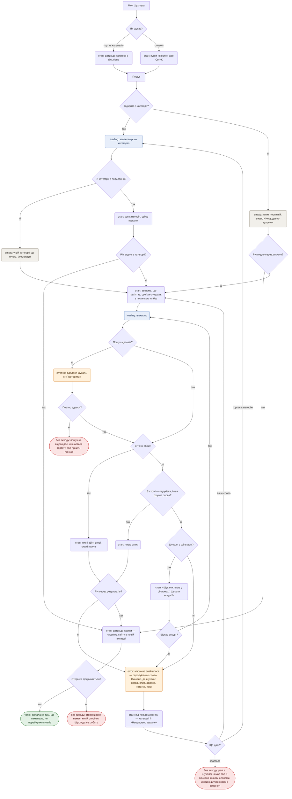

# User flows

Екрани — з реєстру [sitemap.md](sitemap.md), «Екрани»; статуси — з його розділу «Сутності». Jobs — з [11-jtbd.md](research/notes/11-jtbd.md), персони й обставини — з [10-personas.md](research/notes/10-personas.md).

**Нових екранів flows не потребували.** Нові стани, які знайшлися, дописано в `sitemap.md`, «Стани, а не екрани», з позначкою `[?]`.

## Як читати

| Вузол | Форма | Що це |
|-------|-------|-------|
| Екран | `[Назва]`, прямокутник | Назва дослівно з реєстру екранів. Той самий екран може стояти кілька разів, якщо людина туди повертається. «Пошук» і «Посилання» — шари над поточним екраном |
| Розвилка | `{питання?}`, ромб | Дані можуть не прийти, введення може бути хибним, дія може не пройти |
| Стан | `("...")`, заокруглений | Стан екрана, що стоїть перед ним. Підпис починається з типу: `empty`, `error`, `loading`, `стан`, `успіх кроку` |
| Перехід | `("перехід: ...")` | Далі читати інший flow |
| Кінець | `(["..."])`, овал | `успіх`, `кінець` (людина сама зупинилась) або `без виходу` — людина застрягла, і зараз Шухляда не дає їй виходу |

Тип кінця й стану названо словом, колір лише допомагає. `[?]` — те саме, що в `sitemap.md`: припущення. Сторінка сайту — не наш екран, тому вона — стан, а не вузол-екран.

## Чому ці jobs

**Main job** — обов'язковий. До нього обрано три related jobs:

| Job | Чому | Сигнал |
|-----|------|--------|
| **R4** Дістати за тим, що пам'ятається | **Найчастіший біль і ядро MVP.** «Знаю, що збережено, але не можу знайти» часто — 6 з 14; пошук мусить пробачати одруківки й інші форми слова, і саме тут найбільше розвилок, де нічого не знаходиться | Важливість 3 для П1 і П2 (`11`, матриця); `09`, розділ 5 |
| **R3** Мати порядок без сортування | **Найчастіша дія після збереження:** категорію вгадуємо в кожному посиланні. Промах категорії — те, від чого П2 втрачає довіру (`10`, «Чим персони відрізняються») | Важливість 3 для П2, 2 для П1 |
| **E2** Не боятися втратити все разом із сервісом | **Найризикованіший:** видалення акаунта остаточне, а експорт — єдиний спосіб забрати архів. Помилка тут не лагодиться | Важливість 2 для П1 і П2; урок Pocket `03·[A17]` |

**Чому немає окремого flow для R1, R2, E1 і E3.** R1 «відкласти, не відриваючись» і E1 «не тримати в голові» вже всередині main job: вставка, «Поділитися», «не вдалося зберегти» й повернення в Telegram — його розвилки. R2 «що це й навіщо» — там само («Дані сторінки прийшли?») і на шарі «Посилання» у flow R3. E3 — відчуття від «Моєї Шухляди», а не шлях з розвилками. R5 поза MVP.

**Межі.** Частоти — з опитування 14 людей з кола PM: орієнтир, не статистика (`09`, розділ 2). Flows не перевірено на людях.

## Рішення PM (2026-11-22)

Flows показали три тупики; щоб людина в них не застрягала, PM вирішила (бриф §3.1, §3.4, §3.5):
- **Три невдалі спроби** (Main): у повідомленні — «Скопіювати посилання». Посилання не в Шухляді, але людина його не губить і збереже пізніше.
- **Нічого не знайшлося** (R4): сказано, де шукали, а під повідомленням — категорії й «Нещодавно додане», щоб піти гортати.
- **Файл експорту не читається** (E2): CSV з позначкою кодування (BOM) і підказка «Не відкривається в Excel? Відкрий у Google Sheets». Роздільник — `[?]` на етап 3.

Тупик «сторінки сайту вже немає» лишається свідомо: копій сторінок Шухляда не робить (бриф §4).

---

## Main. Відкласти за мить і дістати, коли знадобиться

[Main job](research/notes/11-jtbd.md#main-job). **Персона:** П1 «Скидає з телефона» (primary). **Обставини:** телефон; посилання трапилось у стрічці чи чаті — найчастіше в YouTube, Instagram, Telegram. Відкласти треба одним рухом, не збившись із того, що робить (`10`, П1, job 1); на Android — ще й «Поділитися», на iPhone — лише вставка. Дістає потім, гортаючи очима (`10`, П1, job 2). Flow охоплює два заходи: відкласти зараз і дістати через дні. Job закрито, коли людина відкрила потрібну сторінку.

```mermaid
flowchart TD
    home[Моя Шухляда] --> dSession{"Людина вже ввійшла?"}
    dSession -->|так| loadHome("loading: завантажуємо Шухляду")
    dSession -->|ні| login[Вхід]
    login --> loadLogin("loading: вхід через Google")
    loadLogin --> dLogin{"Вхід вдався?"}
    dLogin -->|так| loadHome
    dLogin -->|ні| errLogin("error: не вдалося увійти, є «Повторити»")
    errLogin --> dLoginRetry{"Повтор вдався?"}
    dLoginRetry -->|так| loadHome
    dLoginRetry -->|ні| deadLogin(["без виходу: без входу не зберегти, лишається спробувати пізніше"])

    loadHome --> dData{"Шухляда завантажилась?"}
    dData -->|ні| errHome("error: не вдалося завантажити Шухляду, є «Повторити»")
    errHome --> dHomeRetry{"Повтор вдався?"}
    dHomeRetry -->|ні| deadHome(["без виходу: Шухляда не відповідає, лишається прийти пізніше"])
    dHomeRetry -->|так| dEmpty
    dData -->|так| dEmpty{"У Шухляді вже є посилання?"}
    dEmpty -->|ні| empty("empty: Шухляда порожня, ілюстрація, поле — єдина дія")
    dEmpty -->|так| list("стан: поле нагорі, «Нещодавно додане», категорії з кількістю")
    empty --> dWay{"Як відкладає?"}
    list --> dWay
    dWay -->|вставкою| paste("стан: дотик до поля, системне «Вставити»")
    dWay -->|"«Поділитися», лише Android"| share("стан: посилання прийшло з «Поділитися»")
    paste --> dIsLink{"Вставлене — посилання?"}
    share --> dIsLink
    dIsLink -->|ні| errNotLink("error: це не посилання, підказка скопіювати посилання [?]")
    errNotLink --> paste
    dIsLink -->|так| dDup{"Таке посилання вже є в Шухляді?"}
    dDup -->|так| dup("стан: «Вже в Шухляді» з переходом до наявного")
    dup --> okDup(["успіх: відкладено раніше, видно, де лежить"])
    dDup -->|ні| dNet{"Є мережа?"}
    dNet -->|ні| errNet("error: не вдалося зберегти — немає мережі, спробуй пізніше. Спроба не рахується")
    errNet --> dNetBack{"Мережа повернулася, поки картка відкрита?"}
    dNetBack -->|так| saving
    dNetBack -->|ні| deadNet(["без виходу: людина закриває картку, посилання лишилося там, де знайшлося"])
    dNet -->|так| saving("loading: вкладається, анімація «вкладання», на картці домен")
    saving --> dSaved{"Збереглося?"}
    dSaved -->|ні| errSave("error: не вдалося зберегти, є «Спробувати ще»")
    errSave --> dTries{"Це була третя спроба?"}
    dTries -->|ні| saving
    dTries -->|так| errFinal("error: третя спроба — повідомлення без повтору і «Скопіювати посилання»")
    errFinal --> dCopy{"Скопіювала посилання?"}
    dCopy -->|так| endCopy(["кінець: у Шухляді посилання немає, але воно в людини — збереже пізніше"])
    dCopy -->|ні| deadSave(["без виходу: людина закриває картку, посилання не збереглося"])
    dSaved -->|так| saved("успіх кроку: «Збережено в Шухляді», домен і категорія, «Змінити», «Скасувати»")
    saved --> meta("loading: підтягується назва, опис, іконка")
    meta --> dMeta{"Дані сторінки прийшли?"}
    dMeta -->|так| full("стан: повні — назва, опис, іконка")
    dMeta -->|ні| domain("стан: лише домен, м'яка заглушка замість іконки")
    full --> dCat{"Категорію вгадано правильно?"}
    domain --> dCat
    dCat -->|ні| linkR3("перехід: flow R3")
    dCat -->|так| dOops{"Вставила випадково? [?]"}
    dOops -->|так| cancel("стан: «Скасувати» — скасовано, картки немає")
    cancel --> endCancel(["кінець: випадкову вставку прибрано, Г5 [?]"])
    dOops -->|ні| dFrom{"Прийшла через «Поділитися»?"}
    dFrom -->|так| back("стан: «Назад» телефона — знову в Telegram")
    dFrom -->|ні| stay("стан: картка зверху «Нещодавно доданого»")
    back --> later("стан: минають дні, річ знадобилася")
    stay --> later

    later --> home2[Моя Шухляда]
    home2 --> load2("loading: завантажуємо Шухляду, збої — як на першому заході")
    load2 --> dRecent{"Річ видно в «Нещодавно доданому»?"}
    dRecent -->|ні| linkR4("перехід: flow R4")
    dRecent -->|так| tap("стан: дотик до картки — сторінка сайту в новій вкладці")
    tap --> dPage{"Сторінка відкривається?"}
    dPage -->|так| ok(["успіх: річ дістала, не пам'ятаючи, де й коли відклала"])
    dPage -->|ні| deadPage(["без виходу: посилання є, а сторінки вже немає. Копій сторінок Шухляда не робить, бриф §4"])

    classDef cOk fill:#e3f1e5,stroke:#2e7d32,color:#1b3d20
    classDef cDead fill:#fbe4e4,stroke:#c62828,color:#4a1212
    classDef cErr fill:#fff1dc,stroke:#d9822b,color:#4a2c0a
    classDef cLoad fill:#e7eefa,stroke:#3d6db5,color:#14284a
    classDef cEmpty fill:#f1efea,stroke:#8a8172,color:#2e2a24
    class ok,okDup cOk
    class deadLogin,deadHome,deadNet,deadSave,deadPage cDead
    class errLogin,errHome,errNotLink,errNet,errSave,errFinal cErr
    class loadHome,loadLogin,saving,meta,load2 cLoad
    class empty cEmpty
```

**Розвилки:**
1. **Людина вже ввійшла?** Ні — «Вхід» (рішення PM 2026-11-21: спершу вхід).
2. **Вхід вдався?** Ні — помилка з «Повторити».
3. **Повтор входу вдався?** Ні — без виходу.
4. **Шухляда завантажилась?** Ні — помилка з «Повторити».
5. **Повтор завантаження вдався?** Ні — без виходу.
6. **У Шухляді вже є посилання?** Ні — порожній стан.
7. **Як відкладає?** Вставкою (iPhone і Android) або «Поділитися» (лише Android).
8. **Вставлене — посилання?** Ні — підказка, знову вставка `[?]`.
9. **Таке посилання вже є?** Так — «Вже в Шухляді»; порівнюємо очищені адреси (бриф §3.1).
10. **Є мережа?** Ні — «не вдалося зберегти» з причиною; спроба не рахується.
11. **Мережа повернулася, поки картка відкрита?** Так — повтор; ні — без виходу.
12. **Збереглося?** Ні — «Спробувати ще».
13. **Це була третя спроба?** Так — повідомлення без повтору, але з «Скопіювати посилання» (бриф §3.1, рішення PM 2026-11-22).
14. **Скопіювала посилання?** Так — кінець, посилання в людини; ні — без виходу.
15. **Дані сторінки прийшли?** Ні — лише домен.
16. **Категорію вгадано правильно?** Ні — flow R3.
17. **Вставила випадково?** Так — «Скасувати» `[?]` (Г5).
18. **Прийшла через «Поділитися»?** Так — «Назад» телефона веде назад у Telegram.
19. **Річ видно в «Нещодавно доданому»?** Ні — flow R4.
20. **Сторінка відкривається?** Ні — без виходу.

**Стани:**
- **empty:** Шухляда порожня — ілюстрація, поле єдина дія.
- **loading:** вхід через Google; завантажуємо Шухляду (на обох заходах); `вкладається`; `підтягується` назва, опис, іконка.
- **error:** не вдалося увійти; не вдалося завантажити Шухляду; вставлене — не посилання `[?]`; немає мережі; не вдалося зберегти; третя спроба — без повтору, з «Скопіювати посилання».
- **стан:** поле й «Нещодавно додане»; посилання з «Поділитися»; «Вже в Шухляді»; `повні`; `лише домен`; `скасовано`; повернення в Telegram; картка зверху списку; сторінка сайту в новій вкладці.
- **успіх кроку:** «Збережено в Шухляді» з «Змінити» і «Скасувати».

**Кінці:**
- **успіх:** річ дістала — job закрито; «Вже в Шухляді» — відкладено раніше.
- **кінець:** випадкову вставку прибрано; після трьох спроб посилання скопійоване — людина збереже пізніше.
- **без виходу:** вхід не вдається; Шухляда не відповідає; без мережі людина закрила картку; три невдалі спроби, а посилання не скопіювала; сторінки вже немає.

**Кліків:** відкласти — 1 (дотик до поля), дістати свіже — 1 (дотик до картки), як у `sitemap.md`, «Глибина».

---

## R4. Дістати за тим, що пам'ятається

[R4](research/notes/11-jtbd.md#r4--дістати-за-тим-що-памятається). **Персона:** П1 (primary), той самий шлях у П2. **Обставини:** річ знадобилася, а в «Нещодавно доданому» її вже не видно (перехід з main job). Пам'ятає «про що воно» — 12 з 14, сайт — лише 2 (`09`, розділ 5). П1 спершу гортає, П2 частіше шукає словом. Ціль — знайти до 10 с (бриф §9).

**Розвилки:**
1. **Як шукає?** Гортає категорію (частіше П1) або словом (частіше П2).
2. **Відкрито з категорії?** Так — шар «Пошук» з фільтром категорії; ні — порожній запит.
3. **У категорії є посилання?** Ні — порожній стан.
4. **Річ видно в категорії?** / **Річ видно серед свіжого?** Ні — вводить запит.
5. **Пошук відповів?** Ні — помилка з «Повторити».
6. **Повтор вдався?** Ні — без виходу.
7. **Є точні збіги?** Ні — шукаємо схожі.
8. **Є схожі — одруківка, інша форма слова?** Так — `лише схожі` (бриф §3.4).
9. **Шукали з фільтром?** Так — «Шукати всюди?» (гіпотеза 3).
10. **Шукає всюди?** Так — новий пошук без фільтра.
11. **Річ серед результатів?** Ні — як «нічого не знайшлося».
12. **Що далі?** Інше слово — новий запит; гортає категорію з тих, що під повідомленням; здається — без виходу (рішення PM 2026-11-22).
13. **Сторінка відкривається?** Ні — без виходу.

**Стани:**
- **empty:** порожня категорія; запит `порожній` — видно «Нещодавно додане» (гіпотеза 4).
- **loading:** завантажуємо категорію; шукаємо.
- **error:** не вдалося шукати; `нічого не знайшлося` — «спробуй інше слово» (бриф §6.4) і де шукали.
- **стан:** уся категорія; вводить запит; `точні збіги`; `лише схожі`; «Шукати всюди?»; під «нічого не знайшлося» — категорії й «Нещодавно додане»; сторінка сайту в новій вкладці.

**Кінці:**
- **успіх:** річ дістала.
- **без виходу:** пошук не відповідає; людина здалася — речі немає або її описано іншими словами, і вона повертається до «загуглити знову», тобто до поведінки П3; сторінки вже немає.

**Найближче, що є, не показуємо**, коли збігів немає: хибні результати підривають довіру `12·[RW4]`.

**Кліків:** категорія → картка — 2; «Пошук» → запит → картка — 2 (`sitemap.md`, «Глибина»).

---

## R3. Мати порядок без сортування

[R3](research/notes/11-jtbd.md#r3--мати-порядок-без-сортування). **Персона:** П2 «Тримає вкладки й закладки» — для неї важливість 3. **Обставини:** комп'ютер, робота; натрапила на корисне, вставила `Ctrl+V` і хоче закрити вкладку (`10`, П2, job 1). Вручну не впорядковує; категорія, що промахується, — те, від чого П2 втрачає довіру (`10`, П2, «Насторожує»). Flow іде від збереження до моменту, коли посилання лежить у правильній категорії.

```mermaid
flowchart TD
    home[Моя Шухляда] --> pasted("стан: Ctrl+V будь-де, збереження як у flow Main")
    pasted --> guess("loading: вкладається, вгадуємо категорію з домену")
    guess --> dRule{"Для цього сайту є правило людини?"}
    dRule -->|так| byRule("стан: категорія з правила сайту")
    dRule -->|ні| dKnown{"Домен є в загальному списку?"}
    dKnown -->|так| byList("стан: категорія за списком, наприклад IMDb — Фільми й серіали")
    dKnown -->|ні| unknown("стан: невідомий домен — «Статті й ресурси» або «Інше»")
    byRule --> confirm("успіх кроку: «Збережено в Шухляді» з категорією і «Змінити»")
    byList --> confirm
    unknown --> confirm
    confirm --> dRight{"Категорія та?"}
    dRight -->|так| okGuess(["успіх: лягло куди треба без жодного кліку"])
    dRight -->|ні| dNoticed{"Помітила, поки підтвердження на екрані?"}
    dNoticed -->|так| change("стан: «Змінити» — вибір із 7 категорій")
    dNoticed -->|ні| laterSeen("стан: помітила пізніше в списку, «⋯» на картці")
    laterSeen --> linkLayer[Посилання]
    linkLayer --> loadLink("loading: відкриваємо посилання")
    loadLink --> dLinkOk{"Посилання відкрилось?"}
    dLinkOk -->|ні| errLink("error: не вдалося відкрити посилання, є «Повторити»")
    errLink --> linkLayer
    dLinkOk -->|так| change2("стан: категорія на шарі «Посилання»")
    change --> saveCat("loading: зберігаємо категорію")
    change2 --> saveCat
    saveCat --> dChanged{"Зміну збережено?"}
    dChanged -->|ні| errChange("error: не вдалося змінити категорію, є «Повторити» [?]")
    errChange --> dChangeRetry{"Повтор вдався?"}
    dChangeRetry -->|ні| deadChange(["без виходу: посилання лишилося в хибній категорії, знайти його можна лише пошуком"])
    dChangeRetry -->|так| changed
    dChanged -->|так| changed("стан: категорія змінена людиною")
    changed --> dMulti{"Сайт з різним вмістом — YouTube, Google, Medium?"}
    dMulti -->|так| okNoRule(["успіх: це посилання на місці, правило не створюємо — наступні вгадуємо як зазвичай"])
    dMulti -->|ні| okRule(["успіх: правило сайту — наступні посилання з нього ляжуть туди самі, старі не чіпаємо"])

    classDef cOk fill:#e3f1e5,stroke:#2e7d32,color:#1b3d20
    classDef cDead fill:#fbe4e4,stroke:#c62828,color:#4a1212
    classDef cErr fill:#fff1dc,stroke:#d9822b,color:#4a2c0a
    classDef cLoad fill:#e7eefa,stroke:#3d6db5,color:#14284a
    class okGuess,okNoRule,okRule cOk
    class deadChange cDead
    class errLink,errChange cErr
    class guess,loadLink,saveCat cLoad
```

**Розвилки:**
1. **Для цього сайту є правило людини?** Так — категорія з правила (рішення PM 2026-11-18, бриф §3.2).
2. **Домен є в загальному списку?** Ні — «Статті й ресурси» або «Інше» (бриф §3.2).
3. **Категорія та?** Так — успіх без кліку.
4. **Помітила, поки підтвердження на екрані?** Так — «Змінити» в підтвердженні; ні — пізніше, через шар «Посилання».
5. **Посилання відкрилось?** Ні — помилка з «Повторити».
6. **Зміну збережено?** Ні — помилка з «Повторити» `[?]`.
7. **Повтор вдався?** Ні — без виходу.
8. **Сайт з різним вмістом?** Так — правило не створюємо; ні — правило сайту.

**Стани:**
- **loading:** `вкладається` і вгадуємо категорію; відкриваємо посилання; зберігаємо категорію.
- **error:** не вдалося відкрити посилання; не вдалося змінити категорію `[?]`.
- **стан:** категорія з правила, за списком або для невідомого домену; вибір із 7 категорій; `змінена людиною`.
- **успіх кроку:** «Збережено в Шухляді» з категорією і «Змінити».
- **empty:** немає — посилання щойно збережене, категорія в нього є завжди.

**Кінці:**
- **успіх:** вгадано правильно; виправлено без правила; виправлено й створено правило сайту.
- **без виходу:** зміна не зберігається — посилання в хибній категорії, гортанням його не знайти.

**Кліків:** вгадано правильно — 0; «Змінити» → категорія — 2; пізніше: «⋯» → категорія → нова категорія — 3.

---

## E2. Не боятися втратити все разом із сервісом

[E2](research/notes/11-jtbd.md#e2--не-боятися-втратити-все-разом-із-сервісом). **Персона:** П1 і П2 — важливість 2 для обох. **Обставини:** людина хоче забрати свій архів — про запас або перед тим, як піти зовсім. Рахуємо за комп'ютером: CSV відкривають у Google Sheets чи Excel (бриф §3.5); на телефоні шлях той самий. Flow закінчується, коли архів у людини, або коли акаунт видалено.

```mermaid
flowchart TD
    home[Моя Шухляда] --> toAcc("стан: пункт «Акаунт» у навігації")
    toAcc --> acc[Акаунт]
    acc --> dWhat{"Що хоче?"}
    dWhat -->|забрати архів| exportBtn("стан: «Експорт» — уся Шухляда в CSV")
    dWhat -->|піти зовсім| delBtn("стан: «Видалити акаунт»")
    delBtn --> offer("стан: пропозиція спершу забрати архів")
    offer --> dTake{"Забирає архів?"}
    dTake -->|так| exportBtn
    dTake -->|ні| warn
    exportBtn --> dHasLinks{"У Шухляді є посилання?"}
    dHasLinks -->|ні| emptyExp("empty: Шухляда порожня, забирати нічого [?]")
    emptyExp --> dLeaving
    dHasLinks -->|так| prep("loading: готується файл [?]")
    prep --> dReady{"Файл готовий?"}
    dReady -->|ні| errExp("error: не вдалося підготувати файл, є «Повторити» [?]")
    errExp --> dExpRetry{"Повтор вдався?"}
    dExpRetry -->|ні| deadExp(["без виходу: архів зараз не забрати, видаляти акаунт не варто — спробувати пізніше"])
    dExpRetry -->|так| file
    dReady -->|так| file("успіх кроку: готово, файл CSV завантажено")
    file --> dOpens{"Файл відкривається з українськими літерами й усіма полями?"}
    dOpens -->|ні| hint("стан: підказка біля «Експорту» — «Не відкривається в Excel? Відкрий у Google Sheets»")
    hint --> dSheets{"У Google Sheets відкрилось?"}
    dSheets -->|так| dLeaving
    dSheets -->|ні| deadFile(["без виходу: файл є, але архів не прочитати [?]"])
    dOpens -->|так| dLeaving{"Йде видаляти акаунт?"}
    dLeaving -->|ні| okExport(["успіх: архів у людини, Шухляда на місці"])
    dLeaving -->|так| warn("стан: попередження «назавжди» — посилання, теги, правила сайтів")
    warn --> dSure{"Підтверджує видалення?"}
    dSure -->|ні| endStay(["кінець: передумала, усе на місці"])
    dSure -->|так| deleting("loading: видаляємо акаунт [?]")
    deleting --> dDeleted{"Видалено?"}
    dDeleted -->|ні| errDel("error: не вдалося видалити, дані на місці, є «Повторити» [?]")
    errDel --> dDelRetry{"Повтор вдався?"}
    dDelRetry -->|ні| deadDel(["без виходу: акаунт лишився, а людина хоче піти — спробувати пізніше"])
    dDelRetry -->|так| login
    dDeleted -->|так| login[Вхід]
    login --> okDeleted(["успіх: акаунт і всі дані видалено назавжди. Архів у людини, якщо забрала"])

    classDef cOk fill:#e3f1e5,stroke:#2e7d32,color:#1b3d20
    classDef cDead fill:#fbe4e4,stroke:#c62828,color:#4a1212
    classDef cErr fill:#fff1dc,stroke:#d9822b,color:#4a2c0a
    classDef cLoad fill:#e7eefa,stroke:#3d6db5,color:#14284a
    classDef cEmpty fill:#f1efea,stroke:#8a8172,color:#2e2a24
    class okExport,okDeleted cOk
    class deadExp,deadFile,deadDel cDead
    class errExp,errDel cErr
    class prep,deleting cLoad
    class emptyExp cEmpty
```

**Розвилки:**
1. **Що хоче?** Забрати архів або піти зовсім.
2. **Забирає архів?** Перед видаленням Шухляда пропонує експорт (бриф §3.5); ні — одразу попередження.
3. **У Шухляді є посилання?** Ні — порожній стан `[?]`.
4. **Файл готовий?** Ні — помилка з «Повторити» `[?]`.
5. **Повтор вдався?** Ні — без виходу.
6. **Файл відкривається з українськими літерами й усіма полями?** Файл зберігаємо з позначкою кодування, тож Excel має показати літери (рішення PM 2026-11-22). Ні — підказка про Google Sheets.
7. **У Google Sheets відкрилось?** Ні — без виходу `[?]`.
8. **Йде видаляти акаунт?** Ні — успіх експорту.
9. **Підтверджує видалення?** Ні — кінець, усе на місці.
10. **Видалено?** Ні — помилка з «Повторити» `[?]`.
11. **Повтор вдався?** Ні — без виходу.

**Стани:**
- **empty:** Шухляда порожня — забирати нічого `[?]`.
- **loading:** `готується` файл `[?]`; видаляємо акаунт `[?]`.
- **error:** `не вдалося` підготувати файл `[?]`; не вдалося видалити акаунт `[?]`.
- **стан:** «Експорт»; підказка «Не відкривається в Excel? Відкрий у Google Sheets»; «Видалити акаунт»; пропозиція забрати архів; попередження «назавжди».
- **успіх кроку:** `готово`, файл завантажено.

**Кінці:**
- **успіх:** архів у людини; акаунт `видалено` → «Вхід».
- **кінець:** передумала.
- **без виходу:** файл не готується; файл не читається ні в Excel, ні в Google Sheets `[?]`; акаунт не видаляється.

**Що flow показав.** Excel відкриває CSV з українськими літерами знаками, якщо файл збережено без позначки кодування. Тоді експорт формально є, а архів не прочитати — E2 провалено. **Рішення PM (2026-11-22):** файл зберігаємо з позначкою кодування (BOM), біля «Експорту» — підказка про Google Sheets. Лишається `[?]` роздільник: Excel з українськими налаштуваннями чекає крапку з комою, з англійськими — кому. На етапі 3 перевіряємо обидва варіанти Excel і Google Sheets; тупик «не читається ніде» лишається лише як перевірка.

**Кліків:** «Акаунт» → «Експорт» — 2; видалення акаунта — 4, свідомо (`sitemap.md`, «Глибина»).
